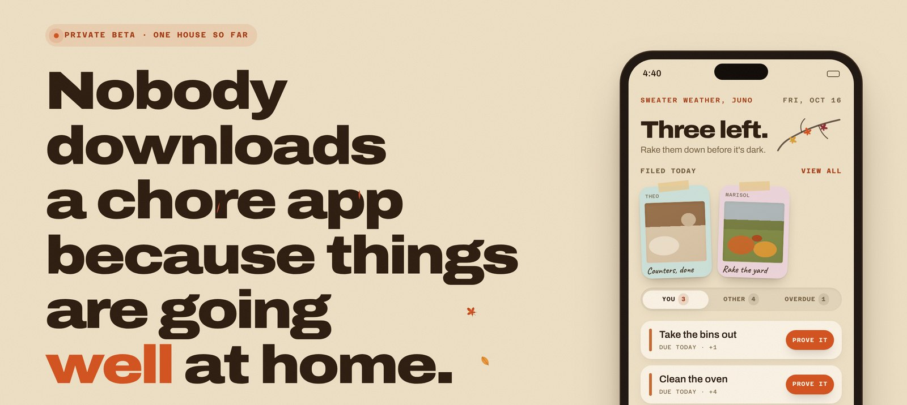
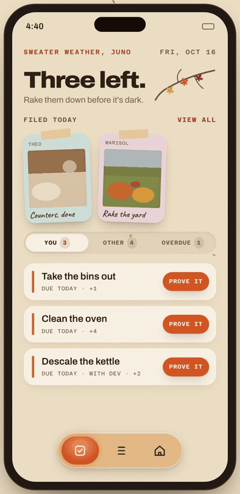
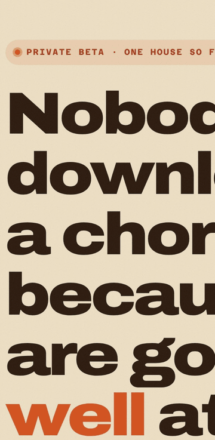
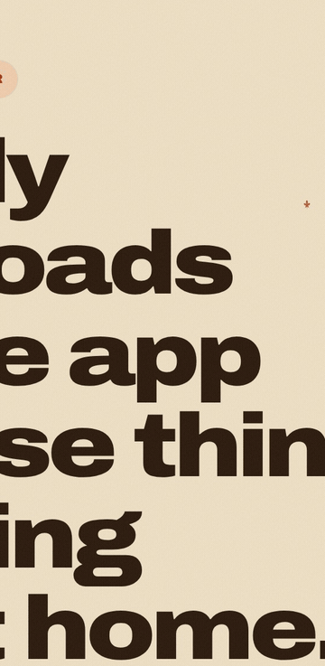
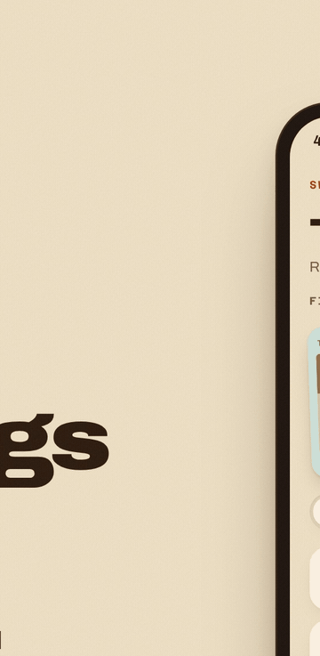
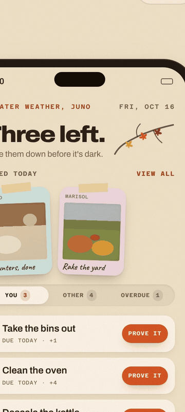
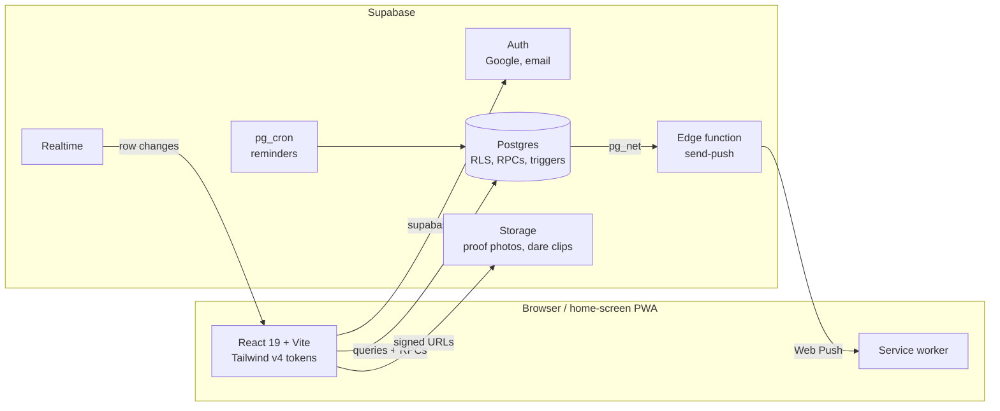

  <picture>
    <source media="(prefers-color-scheme: dark)" srcset="assets/banner-evening.jpg">
    
  </picture>

<h1 align="center">Chorus</h1>

  <strong>The chore app for houses that keep score.</strong> 
  Chorus deals out the chores, asks for a photo as proof, and keeps a ledger nobody can argue with.

  
  
  
  
  
  

---

I built Chorus for my own house. Chores rotate so nobody gets the oven twice in a row. Finishing one means photographing it, and every completion moves your credit for the month. Roommates trade chores with each other, and whoever finishes last at month end spins a wheel of dares the house wrote.

It's in daily use by one household. This repo is a showcase: the source code is private.

## See it work

These are recordings of the landing page's interactive demo, which runs on an invented house ("Alder Lane") with no real data.

<table>
  <tr>
    <td width="50%" valign="top">
       
      <strong>The Board.</strong> Every open chore is a leaf on the branch. Prove one and the camera flashes, the row stamps, the credit pops, and a leaf falls.
    </td>
    <td width="50%" valign="top">
       
      <strong>Photo proof.</strong> An in-app camera, no uploads from the camera roll. The print develops, the stamp lands, and the month's credit counts up.
    </td>
  </tr>
  <tr>
    <td width="50%" valign="top">
       
      <strong>Trades.</strong> Offer your chores to a named roommate for theirs. Accept and both sides swap at once, priced in the same weights the ledger uses.
    </td>
    <td width="50%" valign="top">
       
      <strong>The Forfeit Wheel.</strong> At month end last place spins for a dare the house wrote and voted in, then has a week to film the proof.
    </td>
  </tr>
  <tr>
    <td colspan="2" align="center">
       
      <strong>After dark.</strong> The app computes sunset for the household's timezone and goes warm and dark on its own. No location permission needed.
    </td>
  </tr>
</table>

## What's in it

| | |
|---|---|
| **Rotation** | Weekly or every-N-days chores, dealt round-robin with per-chore offsets so chores on the same schedule don't all land on the same person. Only the current month is materialized. |
| **Credit ledger** | On time, late and missed each carry their own weight, scaled 1× to 3× by how bad the job is. Every total is summed fresh from an append-only ledger. |
| **Crews** | A chore can take several people. Each person photographs their own part, and the chore closes when the last shot lands, enforced by a database trigger rather than the client. |
| **Placeholder roommates** | The house's creator names the roommates up front, and they're real seats in the rotation from day one. Each person inherits their seat when they join. |
| **Governance** | Admin and member roles, invite codes that need an admin's approval, and an audit log of admin actions. |
| **Nudges** | Web push reminders through the day in the household's local time, plus notes, reactions and an activity feed. |
| **Leaf Season** | A seasonal edition with an autumn palette, ambient leaves on a canvas, and a dark palette that switches at local sunset. |

## How it's built

There's no server of its own. Chorus is a static React bundle in front of a hosted Supabase project, and Postgres row-level security is the access control.

| | |
|---|---|
| **Frontend** | React 19, Vite 8 and Tailwind CSS 4, in plain JavaScript. A token-driven design system with a custom motion layer, and a custom `getUserMedia` camera. |
| **Backend** | Supabase: Postgres with row-level security, SECURITY DEFINER RPCs and trigger-enforced invariants. Plus Storage, Realtime, `pg_cron`, and a Deno edge function for Web Push. |
| **Quality** | Vitest suites for the round-robin rotation, ledger and streak math, crew proofs, trade balancing, standings, seasonal sunset math, and copy-length budgets. Linted with oxlint. |
| **Shipping** | Static hosting on Vercel, installed as a PWA via Add to Home Screen. A Capacitor iOS build also exists. |

### A few things I'm proud of

- **The database enforces the rules, not the client.** A crew chore can't be marked done until every seat has filed a photo. A trigger refuses it, so an out-of-date phone can't close a chore on one person's word.
- **Fairness that stays honest.** Trades are priced in the same weights that pay credit, so trading away hard chores also trades away the credit.
- **A theme that follows the sun.** Sunset is computed from the household's timezone with NOAA's solar equations, with tests covering zones whose sunrise falls on the previous UTC day.
- **Designed for phones.** Swipe-back pages, thrown-and-settle sheets, a draggable nav pill on spring physics, and every interaction tuned for an installed iPhone.

## Access

Chorus is private and invite-only for now. To hear when there's room for another house, leave an email on [the live site](https://chore-app-beta.vercel.app).

---

© 2026 William Li. All rights reserved. The images and recordings in this repository may not be reused without permission.

